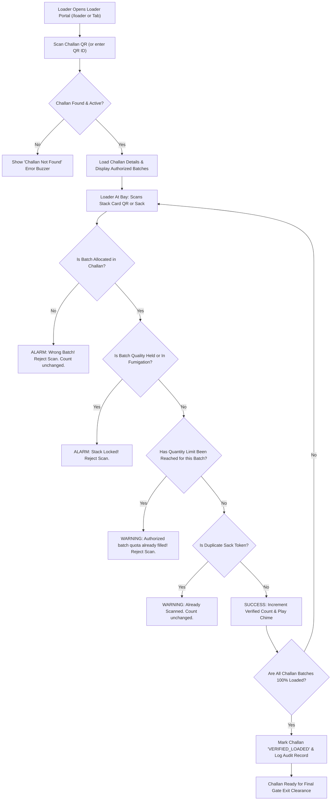

# StockMe — Loader QR Verification Portal Implementation Plan
**Document Version:** 1.0.0  
**Target Application:** FoodStock / StockMe — ePDS Godown FIFO Allocation & Stock Management  
**Author:** Google Antigravity (Advanced Agentic Coding)  
**Date:** October 24, 2026  
**Status:** PROPOSED FOR REVIEW (No application code modified)

---

## Executive Summary

This document presents a comprehensive, existing-build-first plan for integrating a **Loader QR Verification Portal** into the StockMe web application. The design strictly prioritizes the existing architecture, models, Firebase Realtime Database schema, FIFO allocation algorithms, and UI patterns, proposing only the minimum safe extensions necessary.

---

## 1. Existing Implementation Inventory

A rigorous audit of the active codebase was performed. The actual architecture and behaviors are documented below:

### 1.1 Project Structure & Routing
- **Framework & Core:** React 19.3.1, TypeScript 6.0.3, Vite 8.3.5, Tailwind CSS v4, HeroUI v3.2.6 (`@heroui/react`).
- **Main Layout (`src/App.tsx`):**
  - Uses HeroUI vertical tabbed navigation with a collapsible left sidebar (`isSidebarCollapsed`).
  - Active tabs:
    1. `dashboard` (`TabDashboard.tsx`): Real-time KPI cards, commodity summary, storage alerts, and charts.
    2. `critical` (`TabCriticalStock.tsx`): Expiry monitoring (<30 days gap) and inter-godown reallocation.
    3. `batches` (`TabBatches.tsx`): Inward stock register, physical stack cards, driage adjustments, and fumigation toggles.
    4. `dispatch` (`TabDispatch.tsx`): Smart FIFO auto-split allocation, manual batch override, and ePDS Form PDS-DC-04 generation.
    5. `challans` (`TabGeneratedChallans.tsx`): Central statutory challan register with search, filters, and reprint capabilities.
    6. `bays` (`TabBays.tsx`): 12-bay interactive physical godown floor plan (Wing A & Wing B).
    7. `audit` (`TabAudit.tsx`): Immutable regulatory compliance audit log and FIFO exception register.
    8. `scanner` (Header button & tab item): Standalone route switcher.
  - Dedicated Route: `/scan` renders `GatePassScanner.tsx` directly when `window.location.pathname === "/scan"` or `?route=scan`.

### 1.2 Database & Persistence Layer (`src/lib/db.ts` & `src/lib/firebase.ts`)
- **Backend:** Firebase Realtime Database at `foodstock_ipds`.
- **Collections:**
  - `/foodstock_ipds/batches/{batchId}`: Grain stock batches by commodity and bay location.
  - `/foodstock_ipds/challans/{challanId}`: Generated delivery challans and gate exit passes.
  - `/foodstock_ipds/fpsShops/{fpsId}`: Fair Price Shops (consignees).
  - `/foodstock_ipds/exceptions/{excId}`: Signed non-FIFO override authorizations.
  - `/foodstock_ipds/auditLogs/{logId}`: Immutable compliance activity trail.
- **State Synchronization:** Subscribes in real-time via `onValue(ref(db, "foodstock_ipds"))` with immediate local optimistic updates (`handleDispatchSuccess`).

### 1.3 Existing QR Code Types & Exact Payloads

#### A. Physical Stack Card QR Code (`src/components/QRModal.tsx` & `src/components/QRCodeSvg.tsx`)
- **Generator:** Pure SVG vector renderer (`QRCodeSvg.tsx`) wrapping `qrcode`.
- **Level of Identification:** **Batch/Stack level**. Identifies an entire physical grain stack stored in a designated bay (e.g. `Bay A-1`).
- **Actual Encoded JSON Payload:**
  ```json
  {
    "id": "BATCH-WHT-101",
    "commodity": "Wheat",
    "bay": "Bay A-1",
    "qty": 40,
    "storedDate": "2026-07-30",
    "pdsUnit": "iPDS State Godown Unit-4"
  }
  ```

#### B. Statutory Delivery Challan & Gate Pass QR Code (`src/components/ChallanModal.tsx`)
- **Generator:** Embedded on statutory ePDS Form PDS-DC-04.
- **Level of Identification:** **Challan/Consignment level**.
- **Human-Readable QR Identifier:** `qrId` (e.g. `QR-1001`, `QR-1002`).
- **Actual Encoded JSON Payload:**
  ```json
  {
    "type": "GATE_PASS",
    "qrId": "QR-1001",
    "challanNo": "DC-2026-1001",
    "fps": "FPS-101 Adarsh Ration Kendra",
    "fpsId": "FPS-101",
    "commodity": "Wheat",
    "qty": 120,
    "vehicle": "DL-1LM-4402",
    "driver": "Mohan Lal",
    "date": "2026-10-12",
    "status": "PENDING_EXIT",
    "hash": "SEC-1001-120"
  }
  ```

#### C. Individual Sack Identification (Current Status)
- **Status in Codebase:** **Not Present**.
- **Stock Accounting Unit:** Stock is inventoried in **Quintals (Q)**.
- **Packaging Standard:** Standard ePDS package is 50 kg sealed jute bags. Sacks are computed dynamically in UI as:
  $$\text{Bags} = \text{round}(\text{dispatchedQty} \times 2)$$
- There are no individual sack serial numbers, sack RFID tags, or sack QR stickers in the existing database.

### 1.4 Scanning Infrastructure (`src/components/GatePassScanner.tsx`)
- **Engine:** `html5-qrcode` library (`^2.3.8`).
- **Modes:**
  1. Live video stream with front/back camera selection (`facingMode: "environment"`).
  2. Image file upload with client-side canvas decoding (`html5QrCode.scanFile`).
  3. Manual search / Hardware barcode scanner input (triggers on Enter key or direct button press).
- **Audio Feedback:** Synthesizes Web Audio API success chimes (E5 $\rightarrow$ A5) and error buzzers (A3).

### 1.5 FIFO Allocation & Stock Deduction Timing
- **Algorithm:** Strict chronological sorting:
  $$\text{Eligible Batches} = \{ b \in \text{Batches} \mid b.\text{commodity} = C \land b.\text{status} = \text{"Eligible"} \land b.\text{remainingQty} > 0 \}$$
  Sorted ascending by `receiptDate`.
- **Deduction Timing:** **Immediate upon Challan Generation**.
  When `issueDeliveryChallan()` executes in `src/lib/db.ts`:
  - `remainingQty` of all allocated batches is reduced immediately.
  - Batches reaching 0 are set to status `"Depleted"`.
  - The challan is issued with `gateStatus: "PENDING_EXIT"`.
- **Security Exit Clearance:** Performed at the gate post (`updateChallanGateExit()`), marking the challan as `"CLEARED_EXIT"`.

### 1.6 Authentication & Role Authorization
- Currently, the application has no authentication barrier or RBAC framework.
- User identity is recorded as human-readable strings on records:
  - `AuditLog.performedBy`: e.g. `"Godown Dispatch Desk"`, `"Havildar Ramesh (Gate 1)"`.
  - `DeliveryChallan.approvingOfficer`: e.g. `"A. K. Sharma (Assistant Godown Officer)"`.
  - `DeliveryChallan.gateSecurityOfficer`: e.g. `"Assistant Gate Incharge"`.

---

## 2. Requirement-to-Implementation Comparison

| Requirement | Existing Implementation | Gap | Proposed Action |
|---|---|---|---|
| **Challan QR Scanning** | `GatePassScanner.tsx` parses JSON payload, `qrId` (e.g. `QR-1001`), and Challan number (`DC-2026-1001`). | Current scanner is tailored for Gate Security (`CLEARED_EXIT`), not loading dock verification. | Reuse `processDecodedText` logic in a dedicated Loader Portal component (`LoaderVerificationPortal.tsx`). |
| **Retrieving Authorized Batches** | `DeliveryChallan.batches` contains `DispatchedBatchItem[]` (`batchId`, `bayLocation`, `dispatchedQty`, `batchAgeDays`). | Already supported in database and models. | Display allocated stacks with required quantities and bag counts. |
| **Batch Verification During Loading** | `QRModal.tsx` generates Stack Card QRs containing `id` (`BATCH-xxx`), `commodity`, `bay`, and `qty`. | No scanning workflow exists at loading dock to cross-reference loaded stacks with challan stacks. | Accept Stack Card QR scan during loading; verify `id` against `challan.batches`. |
| **Individual Sack Identification** | No individual sack identity or sack QR codes exist in the database or godown. | Physical bags in PDS godowns share the stack card; individual gunny sacks lack unique QR labels. | **Option A (Recommended & Minimal):** Implement **Stack Bag Counter & Scan Protocol** (scan stack QR to confirm location, enter/tap bag counter).<br>**Option B (Optional Extended):** Introduce serialized sack identifiers (`BATCH-xxx-S001`) if barcode labeling is adopted. |
| **Duplicate Scan Prevention** | Not implemented for loading. | Needed to prevent double-counting. | Keep an in-memory & persisted set of scanned sack tokens or stack increments. |
| **Wrong-Batch Detection** | Not implemented for loading. | Need real-time error rejection if a loader pulls from an unallocated stack. | Compare scanned batch ID with authorized batches in the active challan. Trigger error buzzer & visual alarm if mismatched. |
| **Quantity Validation** | Challan defines `dispatchedQty` per batch item. | Loading progress is not tracked per batch. | Enforce that verified bag count for a batch cannot exceed $\text{dispatchedQty} \times 2$. |
| **Loading Verification Status** | `DeliveryChallan` currently only tracks `gateStatus` (`PENDING_EXIT` \| `CLEARED_EXIT`). | No loading stage status (`PENDING_LOADING`, `LOADING_IN_PROGRESS`, `VERIFIED_LOADED`). | Add optional `loadingStatus?: "PENDING" \| "IN_PROGRESS" \| "LOADED"` and `loadingVerifiedAt?: number` to `DeliveryChallan`. |
| **Progress Tracking UI** | Not present for loader role. | Loaders need an easy-to-read, high-contrast, mobile-friendly tally screen. | Create responsive tally cards with progress bars for each allocated batch. |
| **Offline / Network Resilience** | App uses local state optimistic updates when Firebase is slow or offline. | Loss of network during loading could lose count. | Maintain verification state in `localStorage` until finalized and synced. |

---

## 3. Proposed Loader Workflow



### Scenario Walkthroughs

1. **Loader Scans Challan QR:**
   - Scans QR on Form PDS-DC-04 (or types `QR-1001`).
   - Portal displays: FPS Consignee, Vehicle No, Total Quintals & Bags, and each authorized Stack Batch (e.g., `BATCH-WHT-101` in `Bay A-1`: 240 bags).
   - Challan loading state moves to `IN_PROGRESS`.
2. **Valid Stack / Sack Scan:**
   - Loader scans stack card at `Bay A-1` (`BATCH-WHT-101`).
   - System confirms `BATCH-WHT-101` matches Challan allocation.
   - Verified count increments; success chime plays; progress bar updates to $(N / 240)$.
3. **Wrong Batch Scanned:**
   - Loader mistakenly scans `BATCH-RIC-098` from `Bay A-4`.
   - System detects `BATCH-RIC-098` is NOT in the challan's allocated batches.
   - Screen flashes red; error buzzer sounds: *"REJECTED: Batch BATCH-RIC-098 (Rice, Bay A-4) is not authorized for Challan DC-2026-1001 (Wheat required from Bay A-1)"*.
   - Verified counter remains strictly unchanged.
4. **Duplicate Scan:**
   - If unique sack identifiers are used and the same sack token is scanned twice, system alerts: *"Duplicate Scan: Sack #42 already recorded"*. Count does not increase.
5. **Multiple Allocated Batches:**
   - If Challan requires multi-batch FIFO split (e.g., 40 Q from `BATCH-WHT-101` and 80 Q from `BATCH-WHT-102`), the portal displays two separate progress meters.
   - Each scan dynamically maps to its corresponding batch progress bar.
6. **Expected Quantity Reached:**
   - Once all allocated batches reach 100%, scan inputs lock.
   - A prominent green banner appears: *"Truck Consignment Fully Loaded & Verified (240 / 240 Bags)"*.
7. **Network Failure During Loading:**
   - Progress is automatically stored in browser `localStorage` under `loader_session_{challanId}`.
   - If Wi-Fi/cellular drops, scanning continues uninterrupted. Sync occurs as soon as connectivity resumes.
8. **Final Verification Sign-Off:**
   - Loader enters loader/gang head name (e.g. `"Ramu - Loader Gang 2"`) and clicks **"Complete Loading Sign-off"**.
   - Challan record updates with `loadingStatus: "LOADED"`, `loadingSupervisor: "Ramu"`, and `loadingCompletedTimestamp: Date.now()`.
   - Audit trail registers an immutable `DISPATCH_FIFO` loading completion log.
   - When the truck arrives at the godown gate, the Gate Pass Scanner (`/scan`) verifies that loading sign-off is complete.

---

## 4. Minimum Required Changes

To honor the **Source-of-Truth rule**, changes are strictly additive and surgical.

### 4.1 Schema / Type Additions (`src/types/index.ts`)
Only three optional fields are added to `DeliveryChallan`:
```typescript
export interface DeliveryChallan {
  // ... all existing fields preserved unchanged ...
  loadingStatus?: "PENDING" | "IN_PROGRESS" | "LOADED";
  loadingCompletedTimestamp?: number;
  loadingSupervisor?: string;
}
```
*Why necessary:* To distinguish dispatches that are merely generated in the office from dispatches physically confirmed onto the truck bed.  
*Why existing fields cannot be reused:* `gateStatus` tracks gate perimeter departure, not loading dock verification.

### 4.2 Database Service Functions (`src/lib/db.ts`)
Add one helper function:
```typescript
export async function updateChallanLoadingStatus(
  challanId: string,
  status: "IN_PROGRESS" | "LOADED",
  supervisorName: string = "Loader Lead",
  verifiedBagsCount: number
): Promise<void>
```
*Why necessary:* Updates Firebase RTDB `/foodstock_ipds/challans/{challanId}` and appends a loading audit log without altering batch quantities (since stock is already deducted at challan issuance).

### 4.3 New Component: `src/components/LoaderVerificationPortal.tsx`
- **Purpose:** Dedicated UI for loading crew and dock supervisors.
- **Features:**
  - Challan lookup by QR camera scan, image upload, QR ID (`QR-1001`), or Challan number.
  - Active consignment summary card with consignee FPS and transport vehicle.
  - Interactive stack tally meters per allocated batch.
  - Dual camera/scanner support (front/rear camera, hardware scanner, or manual tally increment).
  - Clear visual and audio alarms for wrong-batch, fumigation-locked stock, and over-allocation.
  - Offline `localStorage` caching during active loading sessions.
  - Formal loading completion sign-off button.

### 4.4 Navigation Integration (`src/App.tsx` & `src/components/Header.tsx`)
- Add a new tab: `"Loader Verification"` (icon: `Boxes` or `PackageCheck`) in the sidebar menu.
- Support direct URL route: `/loader` (matching the existing `/scan` pattern).
- Add a quick-access button in the Header: `"Loader Portal"`.

---

## 5. Data Integrity and Security

| Integrity / Security Concern | Mitigation in Proposed Plan |
|---|---|
| **Duplicate Verification** | Scanned bag tokens or increments are tracked in a transient `Set<string>`. Scans exceeding the batch's authorized bag count are rejected. |
| **Wrong-Batch Acceptance** | The scanner strictly cross-references `scannedBatchId` with the `challan.batches` array. Any non-matching batch triggers an immediate audio-visual rejection. |
| **Over-Verification** | Each batch item has an immutable ceiling: $\text{maxBags} = \text{round}(\text{dispatchedQty} \times 2)$. The UI disables further increments once this ceiling is reached. |
| **Unauthorized Challan Access** | The portal only reads existing challans already published in the iPDS system. No draft or deleted records can be accessed. |
| **Concurrent Scans** | Verification updates use atomic Firebase `update()` calls with optimistic local locking. |
| **Invalid Status Transitions** | Status moves strictly monotonically: $\text{PENDING} \rightarrow \text{IN\_PROGRESS} \rightarrow \text{LOADED}$. A challan that has already departed (`CLEARED_EXIT`) cannot be re-loaded. |
| **Unintended Stock Deductions** | **Crucial:** The loader portal **NEVER** touches `batch.remainingQty`. Stock deduction is already finalized when the delivery challan was generated. Loading verification only validates physical fulfillment. |

---

## 6. Backward Compatibility & Regression Risks

1. **Existing Batch QR Codes:** Stack Card QRs generated in `QRModal.tsx` remain 100% identical and compatible. The Loader Portal decodes the exact same JSON format (`{ id, commodity, bay, qty, storedDate }`).
2. **Existing Challan QR Codes:** Challan QRs generated in `ChallanModal.tsx` (`{ type: "GATE_PASS", qrId, challanNo, ... }`) remain 100% identical.
3. **FIFO Allocation Algorithm:** The FIFO logic in `TabDispatch.tsx` remains completely untouched.
4. **Gate Pass Scanner (`GatePassScanner.tsx`):** Continues to function without modification, with the added benefit of being able to display whether loading verification was completed before opening the gate.
5. **No Database Migrations Required:** Since new fields on `DeliveryChallan` (`loadingStatus`, `loadingCompletedTimestamp`, `loadingSupervisor`) are optional, existing challans (`DC-2026-1001` through `1004`) remain completely valid.

---

## 7. Testing Plan

### 7.1 Unit & Logic Tests
- **Challan Decoder Test:** Confirm camera and text inputs correctly parse JSON payloads, `QR-xxxx`, and `DC-xxxx-xxxx`.
- **Batch Matching Test:** Verify that scanning an authorized batch ID increments progress and scanning an unauthorized batch returns a rejection object.
- **Ceiling Enforcement Test:** Verify that when 240 bags are required, the 241st scan is blocked.

### 7.2 Integration Tests
- **Full Loading Lifecycle:**
  1. Generate a Challan for 100 Q Wheat in `TabDispatch`.
  2. Navigate to Loader Portal (`/loader`).
  3. Scan Challan QR.
  4. Scan Stack Card QR from `Bay A-1`.
  5. Verify counter increments to 200 bags.
  6. Attempt to scan `Bay A-4` (Rice under fumigation) $\rightarrow$ confirm rejection.
  7. Finalize loading.
  8. Open Gate Pass Scanner (`/scan`) $\rightarrow$ confirm challan shows "Loading Verified".

### 7.3 Regression Tests
- Verify `npm run build` (`tsc -b && vite build`) compiles with 0 errors.
- Verify existing tabs (`Dashboard`, `Critical`, `Batches`, `Dispatch`, `Challans`, `Bays`, `Audit`) function with zero visual or state regressions.

---

## 8. Implementation Sequence (Upon User Approval)

1. **Step 1: Model & Types Extension**  
   Add optional fields to `DeliveryChallan` in `src/types/index.ts`.
2. **Step 2: Database Service Helper**  
   Add `updateChallanLoadingStatus()` in `src/lib/db.ts`.
3. **Step 3: Component Creation**  
   Create `src/components/LoaderVerificationPortal.tsx` with Challan lookup, stack card scanner, progress tallies, audio chimes, and sign-off flow.
4. **Step 4: Application Wiring & Route Handling**  
   Add route `/loader` and tab in `src/App.tsx`, plus header link in `src/components/Header.tsx`.
5. **Step 5: Gate Pass Cross-Integration**  
   Display loading clearance badge in `src/components/GatePassScanner.tsx`.
6. **Step 6: End-to-End Validation**  
   Verify via browser testing and build check.

---

## 9. Questions and Architectural Assumptions

### Key Finding on Sack Identification
> [!IMPORTANT]
> **Stack-Level QR vs. Sack-Level QR:**  
> The existing StockMe godown application tracks inventory at the **Batch / Bay Stack level** (e.g. `BATCH-WHT-101` in `Bay A-1`, containing 80 Bags / 40 Q). Individual jute sacks do not have individual unique serial stickers in the current system.
> 
> **Proposed Resolution:**
> The Loader Portal is designed to verify that the loader has scanned the **physical Stack Card QR of the authorized Bay**, and enables recording the loaded bag count against that verified stack.
> 
> *Question for User:* Does this stack-level physical verification with bag tally meet your requirement, or do you intend to print individual QR stickers for every single 50 kg jute sack? (Stack-level is recommended as it matches realistic PDS godown operations).

---

## 10. Acceptance Criteria Checklist

- [ ] Dedicated Loader Portal accessible via URL `/loader` and main sidebar navigation.
- [ ] Loader can scan or look up Challan via Challan QR, QR ID (e.g. `QR-1001`), or Challan number.
- [ ] Authoritative challan details render: Consignee FPS, Vehicle No, Total Bags, and Allocated Batches with Bay locations.
- [ ] Loader can scan the physical Stack Card QR code using device camera, hardware scanner, or upload.
- [ ] Scanning an authorized batch increments loaded bag count with audio success chime.
- [ ] Scanning a wrong batch (unauthorized stack or commodity) immediately rejects the scan, sounds an error alarm, and leaves progress unchanged.
- [ ] Scanning a stack under fumigation or quality hold is immediately blocked.
- [ ] Progress bars clearly show loaded bags vs. authorized bags per batch.
- [ ] Progress cannot exceed authorized quota.
- [ ] Loader can sign off on loading completion, which updates challan status and appends an audit log.
- [ ] All existing features (FIFO allocation, Challan printing, Gate Pass exit scanner) continue to function with zero regressions.
