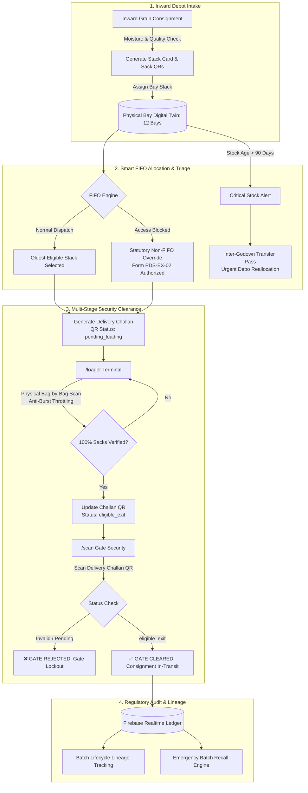

<div align="center">

# 🌾 FoodStock (StockMe)
### *Next-Gen iPDS Godown Smart Allocation, Multi-Tier Security Verification & FIFO Supply-Chain Auditing Platform*

<br/>

[](#-hackathon-championship)
[](#-hackathon-championship)

<br/>

[](https://react.dev/)
[](https://www.typescriptlang.org/)
[](https://vitejs.dev/)
[](https://tailwindcss.com/)
[](https://heroui.com/)
[](https://firebase.google.com/)
[](https://vercel.com/)

<br/>

[🌟 Features](#-core-innovations--main-usps) • [🏛️ Architecture](#-system-architecture) • [🛡️ Security Protocol](#1-🛡️-cryptographic-multi-stage-security-verification--gate-exit-protocol) • [🚨 Critical Stock](#2-🚨-automated-critical-stock-engine--inter-godown-reallocation) • [📱 Portals](#-dedicated-operational-portals) • [🚀 Quick Start](#-quick-start--local-development)

</div>

---

## 🏆 Hackathon Championship

> [!NOTE]
> ### 🥇 **1st Prize Winner — TECHTRIX'26 Hackathon**
> **Host Institution:** I.T.S Engineering College, Greater Noida  
> **Challenge Domain:** Smart Governance, Public Distribution System (PDS / NFSA), Grain Spoilage Prevention & Supply-Chain Anti-Diversion  
> **Official Verdict:** Awarded **First Place** among competitive engineering universities for operational realism, statutory regulatory compliance (NFSA Form PDS-DC & Form PDS-EX-02), zero-trust gate exit verification, and a zero-latency digital twin of physical grain warehouses.

---

## 📌 The Problem: Leaks in the Public Food Supply Chain

India's Public Distribution System handles **80+ Million Metric Tonnes** of wheat, rice, and pulses annually across thousands of State Buffer Godowns and FCI bases. Despite digitization efforts, ground-level operations suffer from severe structural blindspots:

| Challenge | Real-World Failure Mode | FoodStock (StockMe) Solution |
|:---|:---|:---|
| 🌾 **Grain Rot & Spoilage** | Newer inward stocks are placed in front of older stacks; workers dispatch accessible bags first, leaving older grains to decay. | **Autonomous Smart FIFO Allocation**: Traverses all 12 warehouse bays to identify and enforce oldest-batch extraction. |
| 🚚 **Truck Diversion & Gate Theft** | Trucks depart godowns with uninspected sacks or duplicate paperwork before loading is physically verified. | **Cryptographic Multi-Stage Verification**: Dual-portal synchronization (`/loader` ➔ `/scan`) with gate barrier lockout. |
| 👻 **Ghost Allocations** | Paper challans are forged, and bags are diverted into the black market before reaching Fair Price Shops (FPS). | **Vector QR Cryptographic Ledger**: Every delivery challan embeds signed vehicle, driver, batch, and shop hashes. |
| 🚨 **Contamination Inaction** | When an inward batch fails laboratory moisture or pest checks, isolating infected stock takes days. | **Instant Supply-Chain Batch Recall**: Single-click emergency halt isolates all downstream consignments immediately. |

---

## 🏛️ System Architecture

FoodStock acts as a **realtime cyber-physical interface** connecting inward depot arrivals, physical warehouse stack bays, loading docks, and security exit gates into an immutable operational pipeline.



---

## 🌟 Core Innovations & Main USPs

### 1. 🛡️ Cryptographic Multi-Stage Security Verification & Gate Exit Protocol

> [!IMPORTANT]
> **Zero-Trust Gate Clearance**: No truck can physically leave the godown perimeter without passing both the **Physical Loading Tally (`/loader`)** and the **Exit Gate Clearance Terminal (`/scan`)**.

```
[ Delivery Order Created ] ──► Status: pending_loading
             │
             ▼
[ Loading Dock (/loader) ] ──► Loaders scan physical jute bag QRs one-by-one.
             │                 Anti-burst burst throttle stops duplicate scans.
             │                 Progress bar matches Challan metric quintals.
             ▼
[ Loading Confirmed ]      ──► Status flips: eligible_exit
             │
             ▼
[ Godown Exit Gate (/scan)] ──► Gate Security Officer scans Challan QR on handheld terminal.
                               • If pending_loading ➔ ⛔ ACCESS DENIED: TRUCK HALTED
                               • If eligible_exit   ➔ 🟢 CLEARED: GATE OPENED & TIMESTAMP RECORDED
```

* **Physical Sack-to-Challan Tally (`/loader`)**: Built for rugged tablet terminals at loading docks. Loaders scan each sack as it is lifted into the vehicle. Built-in **anti-duplication burst throttling** guarantees that rapid camera re-captures do not flood duplicate scans.
* **Dynamic Lifecycle QR Payloads**: The Delivery Challan QR is dynamic. It only permits exit when the physical bag count matches the certified consignment weight.
* **Gate Security Scanner Terminal (`/scan`)**: Operates on a dedicated route with high-contrast audio-visual signals for guards. Once cleared, the exit timestamp, truck plate, driver acknowledgement, and guard ID are cryptographically stamped into the immutable Firebase audit log.

<details>
<summary><b>🔍 View Cryptographic Delivery Challan QR Schema (JSON Payload)</b></summary>

```json
{
  "type": "DELIVERY_CHALLAN",
  "qrId": "QR-1004",
  "challanNo": "DC-2026-1004",
  "status": "eligible_exit",
  "loadingStatus": "LOADED",
  "gateStatus": "PENDING_EXIT",
  "fps": "Fair Price Shop #104 (East Delhi)",
  "fpsId": "FPS-104",
  "commodity": "Wheat",
  "qty": 80,
  "bags": 160,
  "vehicle": "DL-1LM-4402",
  "driver": "Mohan Lal",
  "date": "2026-10-24",
  "supervisor": "Loading Supervisor S. Sharma",
  "hash": "SEC-1004-80-VERIFIED-ePDS"
}
```
</details>

---

### 2. 🚨 Automated Critical Stock Engine & Inter-Godown Reallocation

> [!WARNING]
> Grains stored beyond 90 days in tropical humidity face high pest infestation and moisture decay. FoodStock transforms passive rotting into active supply redistribution.

* **Quarter-Life Visual Triage**: Every stack in the godown is monitored dynamically based on its receipt date and storage age:
  * 🔴 **Critical Tier (<30 Days to Expiry / >90 Days in Godown)**: Triggers animated urgent alerts and pushes batches to the top of the command screen.
  * 🟡 **Warning Tier (30–60 Days)**: Flagged for accelerated allocation.
  * 🟢 **Optimal Tier (>60 Days)**: Regular FIFO storage queue.
* **One-Click Inter-Godown Emergency Reallocation**: Instead of letting critical grains spoil in low-demand buffer units, Godown Officers can initiate an **Emergency Inter-Godown Stock Transfer**. The system:
  1. Identifies nearby high-demand government buffer units (e.g., *State Buffer Godown Unit-2 East*, *Unit-3 North*, *Unit-5 South*).
  2. Generates an official printable **Inter-Godown Transfer Pass** with statutory officer authorization.
  3. Automatically deducts transferred quintals from local warehouse stacks and updates live bay capacities in real time.

---

### 3. ⚡ Autonomous Smart FIFO Allocation Engine

* **Oldest-Batch Priority**: When issuing grain to Fair Price Shops, the FIFO engine evaluates receipt dates across all bays and automatically prescribes the exact bay and batch ID that must be unloaded first.
* **Statutory Non-FIFO Override Protocol (Form PDS-EX-02)**: In cases where an older stack is inaccessible (e.g., active aeration or forklift corridor blockage), officers can authorize an override. This requires:
  * Selection of approved statutory reason (*Physical Access Blocked*, *Fumigation in Progress*, *Quality Re-check*, etc.).
  * Documented officer justification remarks.
  * Automatic logging into the public **Non-FIFO Exceptions Register** for state vigilance review.

---

### 4. 📦 12-Bay Godown Digital Twin & Stack Card Management

* **Spatial Floor Plan**: Full visual matrix of **Bays A-1 through A-6** and **B-1 through B-6**.
* **Live Environmental Stack Cards**: Displays commodity name, stack card ID, current moisture percentage, and bag count.
* **Fumigation Quarantine Lockout**: Stacks undergoing 7-day Aluminum Phosphide (ALP) gas cover aeration are locked out from dispatch engines to prevent toxic exposure.
* **Driage Logging**: Records standard moisture evaporation losses in accordance with Food Corporation of India (FCI) storage loss norms.

---

### 5. 🔍 End-to-End Batch Traceability & Emergency Recall

```
[ Central Inward Depot ] ──► [ Bay Stack A-3 ] ──► [ DC-1001 (FPS #102) ] ──► [ Beneficiary Ration ]
                                       │
                                       └──► [ DC-1004 (FPS #104) ] ──► [ Beneficiary Ration ]
                                       │
                                [ EMERGENCY RECALL TRIGGERED ]
                                       ▼
                       • All in-transit trucks halted
                       • Receiving FPS portals alerted
                       • Bay stack locked against further dispatch
```

* **Consignment Lineage**: Inspect any batch ID to see which supplier depot delivered it, how long it was stored in which bay, and every single Delivery Challan that sourced grain from it.
* **Single-Click Supply-Chain Recall**: If a grain stack fails lab tests, officers can trigger an emergency recall, isolating all related downstream consignments across trucks and ration shops.

---

### 6. ⚙️ Master Commodity Catalog & Officer Credentials

* **Dynamic Commodity Catalog**: Administrators can register new grains, pulses, and state-extended supplies (e.g., *Bajra*, *Barley*, *Mustard Seeds*, *Ragi*, *Jowar*). Newly registered items immediately activate in Inward Consignment intake, Smart FIFO allocation, inventory filters, and real-time analytics.
* **Official Signature Stamp Personalization**: Update the Authorized Officer Name, Official Rank/Designation, and Godown Facility Name. Includes a live preview of the government dispatch stamp printed on delivery challans.

---

## 📱 Dedicated Operational Portals

| Route | Target User | Hardware Target | Primary Capabilities |
|:---:|:---:|:---:|:---|
| `/` | **Godown Commander / Assistant Godown Officer (AGO)** | Desktop / Laptop / Office Workstation | Command dashboard, FIFO dispatch allocation, 12-bay floor plan, audit ledger, critical stock transfer, settings. |
| `/loader` | **Loading Supervisor / Dock Workers** | Rugged Tablet / Handheld Industrial Scanner | Real-time sack-by-sack QR camera scanner, anti-burst duplicate filter, loading progress bar, clearance approval. |
| `/scan` | **Exit Gate Security Officer / Guard** | Handheld Mobile / Smartphone at Gatepost | High-contrast Challan QR camera reader, instant green/red barrier exit authorization, audio-visual feedback. |

---

## 💻 Tech Stack & Engineering Highlights

```
┌────────────────────────────────────────────────────────────────────────┐
│                          FOODSTOCK FRONTEND STACK                      │
├───────────────────┬────────────────────────────────────────────────────┤
│ Framework         │ React 19 (Hooks, Concurrent Rendering, Fast HMR)   │
│ Language          │ TypeScript 5 (Strict Mode, Zero Any)               │
│ Build Tool        │ Vite 8 (Ultra-fast Rolldown Production Bundler)    │
│ Component System  │ HeroUI (Pure Collection-Driven Enterprise UI)      │
│ Styling Engine    │ Vanilla Tailwind CSS v4 (No Custom CSS Slop)       │
│ Realtime Database │ Firebase Realtime DB (Live multi-device websocket) │
│ Icons             │ Lucide React (Official government glyph set)       │
│ Vector QR Engine  │ Native SVG Matrix Renderer (Offline, zero-latency) │
└───────────────────┴────────────────────────────────────────────────────┘
```

> [!TIP]
> **Zero "AI Slop" Design Philosophy**: The interface strictly adheres to clean government ergonomics with pure HeroUI cards, tables, chips, and modals. The sidebar menu features full-width solid blue rectangular highlights with sharp 90-degree corners and zero padding gaps for high-contrast visibility.

---

## 🚀 Quick Start & Local Development

### Prerequisites
* **Node.js**: `v18.0.0` or higher
* **Package Manager**: `npm` (v9+) or `pnpm`

### Installation

1. **Clone the repository:**
   ```bash
   git clone https://github.com/lovechn1407-debug/StockMe.git
   cd StockMe
   ```

2. **Install dependencies:**
   ```bash
   npm install
   ```

3. **Configure Firebase (Optional):**
   FoodStock includes an instant **offline buffer mode** with realistic pre-seeded buffer godown data. To connect your live cloud database, create a `.env` file in the root:
   ```env
   VITE_FIREBASE_API_KEY="your-api-key"
   VITE_FIREBASE_AUTH_DOMAIN="your-app.firebaseapp.com"
   VITE_FIREBASE_DATABASE_URL="https://your-app-default-rtdb.firebaseio.com"
   VITE_FIREBASE_PROJECT_ID="your-project-id"
   VITE_FIREBASE_STORAGE_BUCKET="your-app.appspot.com"
   VITE_FIREBASE_MESSAGING_SENDER_ID="your-sender-id"
   VITE_FIREBASE_APP_ID="your-app-id"
   ```

4. **Launch development server:**
   ```bash
   npm run dev
   ```
   Navigate to `http://localhost:5173` in your browser.

5. **Run production build & validation:**
   ```bash
   npm run build
   ```

---

## 🖨️ Statutory Print Compliance

<details>
<summary><b>📄 Click to expand Government Form Compliance Details</b></summary>

FoodStock includes native print stylesheets formatted strictly for official Indian administrative documentation:
* **Form PDS-DC (Triplicate Delivery Challan)**:
  * *Original Copy (Pink)*: Retained by Fair Price Shop Dealer.
  * *Duplicate Copy (Yellow)*: Signed by Transporter / Truck Driver.
  * *Triplicate Copy (White)*: Permanent Godown Office Audit Record.
* **Form PDS-EX-02 (Statutory FIFO Exception Certificate)**: Formally signed by Assistant Godown Officers documenting non-FIFO emergency allocations.
* **Central Warehousing Corporation (CWC) Stack Monitoring Card**: Printable warehouse stack card containing moisture checks, date of receipt, and stack dimensions.
</details>

---

## 🎖️ Acknowledgments & Hackathon Credits

* **I.T.S Engineering College, Greater Noida** for hosting **TECHTRIX'26** and fostering innovation in public distribution and smart governance.
* **Department of Food & Public Distribution (DFPD)** & **Food Corporation of India (FCI)** for foundational guidelines on buffer godown norms.
* The jury and faculty mentors at TECHTRIX'26 for evaluating and awarding **1st Place** to FoodStock (StockMe).

---

<div align="center">

🏆 **TECHTRIX'26 — 1st Position Champion Project**  
<sub>Developed with passion for transparent, rot-free, and leakage-proof national food security.</sub>

</div>
